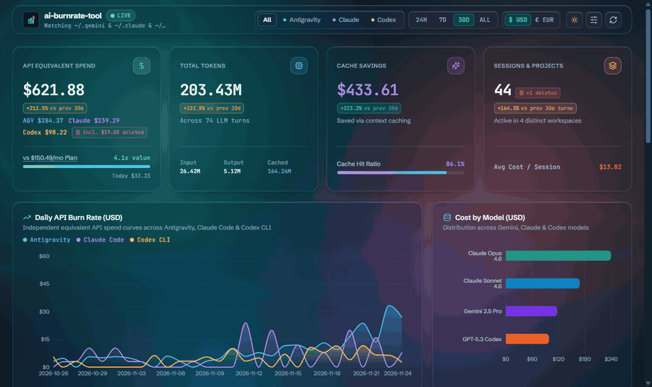

<div align="center">

<a href="https://cise07.github.io/ai-burnrate-tool/">
  
</a>

### **Real-Time Local Token & API Equivalent Cost Tracker for Antigravity CLI, Claude Code & Codex CLI**

[](https://cise07.github.io/ai-burnrate-tool/)
[](https://nodejs.org/)
[](https://github.com/Cise07/ai-burnrate-tool)
[](#-key-features)

Track live token consumption, **pay-as-you-go API equivalent spend (`$ USD` / `€ EUR`)**, Prompt Caching savings, subagents & `/btw` side-chats, and subscription ROI across **Antigravity CLI**, **Claude Code**, and **Codex CLI** — **100% locally, with zero cloud uploads.**

[🌐&nbsp;Website](https://cise07.github.io/ai-burnrate-tool/) · [🚀&nbsp;Quick&nbsp;Install](#-quick-install) · [✨&nbsp;Features](#-key-features) · [🎮&nbsp;CLI&nbsp;Flags](#-usage--cli-flags) · [🔄&nbsp;Reset](#-per-tool-tracking-reset--resume) · [💾&nbsp;Backup](#-portable-backup--restore) · [🪝&nbsp;Hooks](#-offline-auto-archive-hooks--zero-daemon-background-sync) · [💰&nbsp;Pricing](#-how-pricing--historical-rate-versioning-work)

<br />

<a href="https://cise07.github.io/ai-burnrate-tool/">
  
</a>

<sub>🌐 Try the interactive showcase on the <a href="https://cise07.github.io/ai-burnrate-tool/"><b>official website</b></a>.</sub>

</div>

---

## 🚀 Quick Install

> **Prerequisite:** [Node.js (>= 18)](https://nodejs.org/) and `npm`. Works on **Windows, macOS, and Linux**.

### 1. Install globally

```bash
npm install -g ai-burnrate-tool
```

### 2. Run from any folder

```bash
burn          # 🟢 Launch live Web Dashboard + real-time file watcher & mobile QR
burn --cli    # 🖥️ Print an instant colorized ANSI report directly in your terminal
```

<details>
<summary><b>More install options</b> (run once with <code>npx</code>, pin a version, or uninstall)</summary>

<br />

- **Run once without installing:**
  ```bash
  npx ai-burnrate-tool
  ```
- **Install a specific version:**
  ```bash
  npm install -g ai-burnrate-tool@X.Y.Z
  ```
- **Update to latest release:**
  ```bash
  burn --update
  ```
- **Uninstall completely:**
  ```bash
  burn --uninstall
  # or: npm uninstall -g ai-burnrate-tool
  ```

</details>

---

## ✨ Key Features

- 🔒 **100% Local, Dynamic & Cross-Platform:** Automatically resolves `~/.gemini`, `~/.claude`, and `~/.codex` (or `$CODEX_HOME`) on Windows, macOS, and Linux with zero hardcoded paths. Override directories anytime via `BURNRATE_GEMINI_DIR`, `BURNRATE_CLAUDE_DIR`, and `BURNRATE_CODEX_DIR`.
- 🤖 **Automatic Subagent & `/btw` Side-Chat Roll-Up:** Subagents (`image-generator`, `research`, Claude `/subagents/*.jsonl`, Codex multi-agent threads) and ephemeral **`/btw` / `/side`** side-chats across Antigravity CLI, Claude Code, and Codex CLI roll cleanly into their parent chat and project workspace without double-counting — preserved with **expandable & searchable individual `/btw` titles**, turns, tokens, models, and costs even after dismissing with `Esc` or archiving.
- 🔄 **Per-Tool Spend Reset & Resume from Any Date:** Start counting spend for any individual tool (`Antigravity`, `Claude Code`, `Codex CLI`) from **right now** or **any custom date/time** (e.g. migrating from a third-party API to a native plan, or starting a new billing cycle) — filtering strictly per turn without touching any AI tool files, and fully reversible from any date or from the beginning.
- 💾 **Portable Backup & Restore (`~/.burnrate`):** Export your entire local archive (sessions & deleted chats ledger, `/btw` turns, historical pricing snapshots, subscription plans, layout & tool cutoffs) into a single portable `.json` file and restore it in safe **Merge** (default) or **Replace** mode from either Settings UI or the CLI — even on a brand-new machine before installing your AI CLIs.
- 🪝 **Offline Auto-Archive Hooks (`--sync-ledger`):** Automatically installs lightweight native lifecycle hooks (`Stop`, `SubagentStop`, `SessionEnd`) for Antigravity, Claude Code, and Codex CLI so completed turns, subagents, and `/btw` chats are atomically snapshotted into `~/.burnrate/sessions-ledger.json` even while `burn` is closed.
- 📱 **Mobile & LAN Access (`ai-burnrate.local` mDNS + 6-Digit PIN + QR):** Running `burn` binds to `0.0.0.0`, advertises **`http://ai-burnrate.local:<port>`** via built-in mDNS/Bonjour (with LAN IP fallback), and prints a random **6-digit PIN** + scannable **terminal QR code**. Localhost stays instant-access, while LAN devices authenticate with constant-time PIN verification, per-IP rate limiting, and `HttpOnly` cookies.
- 🫧 **Liquid Glass Light & Dark Dashboard:** Dual **Sunlit Porcelain Mist (Light)** and **Deep Ocean Petrol (Dark)** themes with frosted translucent surfaces, iOS-inspired refractive floating navigation bar, native accessible `<dialog>` modals, and self-hosted variable fonts (zero external CDN requests).
- 🟢 **Live Dashboard & Server-Sent Events (SSE):** A background `chokidar` watcher streams instant updates to KPIs, charts, heatmap, and session tables via `/api/events`.
- 🏷️ **30-Minute `ETag` Auto-Sync & Long-Context Tiers:** Keeps model tariffs fresh automatically at startup, every 30 minutes while running, on manual **Rescan**, and opportunistically in the background from offline hooks (`--sync-pricing` with atomic lock and `If-None-Match` → `304 Not Modified`), appending immutable `effectiveFrom` snapshots to `~/.burnrate/pricing-ledger.json` and applying **per-request long-context tiers** (`>272k` on GPT-5.4/5.5/5.6/6.x, `>200k` on Gemini 2.5 Pro) only on tiered models.
- 💱 **Instant `$ USD` / `€ EUR` Switch & Tax-Accurate Subscriptions:** API equivalent spend remains pure net pay-as-you-go, while customizable monthly subscription plans (including **Google AI Plus/Pro/Ultra**, **Claude Pro/Max**, and **ChatGPT Go/Plus/Pro** presets) automatically convert and include retail taxes (+22% VAT in EUR, +7.5% Sales Tax in USD).
- 🧩 **Customizable Dashboard Layout:** Reorder (drag & drop) or hide any section from Settings with persistence in `~/.burnrate/settings.json`.
- 🖥️ **Instant Terminal Mode (`--cli`):** Prints colorized ANSI tables (Tool Breakdown, Model Breakdown, Workspaces → Chats → Subagents hierarchy, and Deleted Chats) with `--eur`, `--tool`, `--range`, and `--json` support.

---

## 🎮 Usage & CLI Flags

Once installed, the **`burn`** command is available globally from any directory:

| Command | Description |
| :--- | :--- |
| `burn` | 🟢 **Live Mode (Default):** Syncs official pricing, ensures offline archive hooks are active, starts the HTTP + SSE server on `0.0.0.0` (localhost + protected LAN access via 6-digit PIN & terminal QR), watches `~/.gemini`, `~/.claude` & `~/.codex`, and opens the React Dashboard. |
| `burn --cli` | 📊 **Terminal Mode:** Syncs pricing, prints the workspace/chat/subagent token & cost report in colorized ANSI tables, and exits immediately. |
| `burn --eur` | 💶 **EUR Mode (Web UI & CLI):** Displays costs in EUR (`€`) instead of USD (`$`) in both Web Dashboard and `--cli` output. |
| `burn --tool <tool>` | 🔎 **Tool Filter (Web UI & CLI):** Filters output by `all`, `antigravity`, `claude`, or `codex`. |
| `burn --range <range>` | 🕒 **Time Range (Web UI & CLI):** Filters output by `24h`, `7d`, `30d`, or `all`. |
| `burn --cli --json` | 🧾 **CLI JSON Output:** Prints aggregated workspaces, chats, subagents, and per-model breakdowns as JSON. |
| `burn --reset-tool <tool>` | 🔄 **Reset Tool Spend:** Starts counting spend & stats from now (or `--since <date>`) for `antigravity`, `claude`, `codex`, or `all` without touching tool files. |
| `burn --restore-tool <tool>` | ⏪ **Restore Tool History:** Restores spend history from the beginning (or from `--since <date>`) for `antigravity`, `claude`, `codex`, or `all`. |
| `burn --since <date>` | 📅 **Custom Cutoff Date:** Optional `YYYY-MM-DD` or ISO-8601 timestamp used with `--reset-tool` or `--restore-tool`. |
| `burn --export-backup [file]` | 💾 **Export Backup:** Snapshots live transcripts and exports `~/.burnrate` (sessions ledger, pricing history & settings) into a portable `.json` file (`burnrate-backup-YYYY-MM-DD.json` by default). |
| `burn --import-backup <file>` | 📥 **Import Backup:** Restores a Burnrate backup `.json` file into `~/.burnrate`, safely **merging** with existing local data by default. |
| `burn --replace` | 🔁 **Replace Mode (Backup Import):** Used with `--import-backup <file>` to overwrite local `~/.burnrate` data instead of merging. |
| `burn --no-open` | 🔇 **Headless Mode:** Starts the live server and file watcher without opening the browser. |
| `burn --no-hooks` | 🔕 **Skip Hooks:** Launches without installing Antigravity/Claude/Codex offline archive hooks. |
| `burn --uninstall-hooks` | 🧹 **Remove Hooks:** Removes `ai-burnrate-tool` offline archive hooks from Antigravity, Claude Code & Codex CLI configs. |
| `burn --sync-ledger` | 🪝 **Hook Snapshot Mode (Internal):** Invoked by tool hooks to snapshot the active transcript into `~/.burnrate/sessions-ledger.json` and trigger a detached `--sync-pricing` if ≥ 30 minutes have elapsed. |
| `burn --sync-pricing` | 🏷️ **Background Price Sync (Internal):** Refreshes `~/.burnrate/pricing-ledger.json` via conditional `ETag` (`304 Not Modified`) and exits silently. |
| `burn -p, --port <number>` | 🔌 **Custom Port:** Starts the dashboard on a specific port (default: `4321`, automatically falling back to the next free port if busy). |
| `burn --update` | ⬆️ **Self-Update:** Updates `ai-burnrate-tool` to the latest version from npm. |
| `burn --uninstall` | 🗑️ **Self-Uninstall:** Removes offline hooks and uninstalls `ai-burnrate-tool` globally. |
| `burn -V, --version` | 🏷️ Prints the installed version. |
| `burn -h, --help` | ℹ️ Displays all available CLI options. |

> 💡 **Clean Shutdown:** While running in live mode (`burn`), press `Ctrl+C` (`SIGINT`) to cleanly close all SSE streams, active HTTP sockets, and the `chokidar` file watcher.

---

## 🔄 Per-Tool Tracking Reset & Resume

Need to start from `$0.00` for one tool (for example, switching Claude Code from a third-party API to a native plan, or aligning stats to a new billing date) **without deleting any chats**?

- **Turn-level precision:** Setting a start timestamp for a tool (`antigravity`, `claude`, or `codex`) excludes every turn before that moment across KPIs, charts, heatmap, ROI projections, CSV/JSON exports, and Deleted Chats. If you continue an older chat afterward, only the new post-reset turns are counted — even if you later delete that chat.
- **Zero-destruction & reversible:** Your real tool folders (`~/.gemini`, `~/.claude`, `~/.codex`) and archive ledger remain completely intact. You can resume counting from **any specific date** or restore **from the beginning** anytime via **Settings**, the active **Dashboard Banner**, or the CLI:

```bash
burn --reset-tool claude                        # Zero out Claude Code starting from right now
burn --reset-tool claude --since 2026-11-01     # Count Claude Code starting from Nov 1
burn --restore-tool claude --since 2026-11-15   # Resume counting from a specific earlier date
burn --restore-tool claude                      # Restore full history from the beginning
```

---

## 💾 Portable Backup & Restore

Moving to a new machine or formatting your OS? Export your entire `~/.burnrate` state (**sessions & deleted chats ledger**, preserved `/btw` side-chats, **historical pricing snapshots**, and **user settings/plans/cutoffs**) into one validated JSON bundle — and restore it anytime from **Settings → Portable Backup & Restore** or the CLI:

```bash
burn --export-backup                            # Writes ./burnrate-backup-YYYY-MM-DD.json
burn --export-backup ~/backups/burnrate.json    # Export to a custom file or directory
burn --import-backup burnrate-backup.json       # Safe Merge mode (preserves newer local sessions & turns)
burn --import-backup burnrate-backup.json --replace  # Full Replace mode
```

- **Works even on a clean PC:** Imported sessions appear immediately in your totals, charts, heatmap, and archive even before `~/.gemini`, `~/.claude`, or `~/.codex` exist on the new machine, and automatically reconnect to live chats once matching transcripts appear on disk.

---

## 🪝 Offline Auto-Archive Hooks & Zero-Daemon Background Sync

`ai-burnrate-tool` never installs persistent OS services or cron jobs. Instead, it uses each AI CLI's native lifecycle hooks (only for tools already installed on your machine, preserving any existing custom hooks):

| Tool | Config File | Events Installed |
| :--- | :--- | :--- |
| **Antigravity CLI** | `~/.gemini/config/hooks.json` | `Stop` (`5s`) |
| **Claude Code** | `~/.claude/settings.json` | `Stop` (`5s`), `SubagentStop` (`5s`), `SessionEnd` (`5s`) |
| **Codex CLI** | `~/.codex/hooks.json` (or `$CODEX_HOME/hooks.json`) | `Stop` (`5s`), `SubagentStop` (`5s`), `SessionEnd` (`3s`) |

When an AI turn finishes — even while `burn` is closed — the tool triggers `burn --sync-ledger`:
1. **Read-Only Transcript Snapshot:** Reads the updated transcript (never modifying AI tool files) and atomically writes the latest turns, subagents, and `/btw` side-chats into `~/.burnrate/sessions-ledger.json`.
2. **30-Minute Background Pricing Check:** Compares `lastSyncCheckedAt` in `~/.burnrate/pricing-ledger.json` (`<1ms`). If at least **30 minutes** have passed, it atomically acquires `~/.burnrate/.pricing-sync.lock` (`O_CREAT | O_EXCL`, preventing concurrent duplicate spawns, with automatic 60s stale-lock recovery) and spawns a detached `burn --sync-pricing` worker with `.unref()` — adding zero latency to your AI chat.
3. **Instant Return:** Prints `{}` and exits cleanly so the AI loop continues uninterrupted.

---

## 💰 How Pricing & Historical Rate Versioning Work

`ai-burnrate-tool` uses a time-versioned pricing engine (`src/core/pricing.ts`) so provider price updates never distort past spending history:

1. **Initial Seed (`config/pricing.json`):** Provides baseline rates (effective from `1970-01-01T00:00:00.000Z`) and offline fallback for **Claude** (*Opus 5.5 / 4.x, Sonnet 4.x, Haiku*), **Google Gemini** (*Gemini 4 Argon / Carbon / Neon / Hydrogen, 3.8 Flash, 2.5 Pro / Flash / Flash-Lite*), and **OpenAI / Codex** (*GPT-6.2 Astra / Sol, GPT-6.1 Sol / Terra, GPT-6 Astra / Sol / Luna / Cyber / Rosalind, GPT-5.6 Sol / Terra / Luna / Cyber, GPT-5.5 / 5.5 Pro / 5.5 Cyber, GPT-5.4 / Pro / Mini / Nano, GPT-5.3 / 5.2 / 5.1 / 5 Codex, GPT-4.1, o3 / o3-pro / o3-mini, o4-mini*).
2. **Automatic Live & Background Sync (`syncOfficialPricing`):** At launch, every **30 minutes** while the dashboard is open, via manual **Rescan** (forced fresh fetch), and opportunistically in the background (`--sync-pricing`, detached with an atomic lock) from offline hooks, `ai-burnrate-tool` checks the official **LiteLLM Model Pricing Registry** and repository feed using conditional **`ETag` (`If-None-Match` → `304 Not Modified`)** for ~50ms zero-byte checks when unchanged.
3. **Immutable Historical Ledger (`~/.burnrate/pricing-ledger.json`):** Whenever a model's `input`, `output`, `cacheRead`, `cacheWrite`, or `longContext` tier actually changes, a new `RateSnapshot` stamped with `effectiveFrom` (pinned to LiteLLM's exact commit timestamp clamped safely after the previous verified sync) is appended atomically (`tmp` + `rename`) without overwriting historical rates. When tariffs don't change, `pricing.history` adds 0 bytes.
4. **Per-Turn Timestamp Matching (`getHistoricalRate`):** Each parsed turn matches its timestamp against `pricing.history` (and verifies any promotional window `promoStart` / `promoEnd`), keeping prior turns permanently valued at their original tariff.
5. **Per-Request Long-Context Tiering (`calculateTurnCost`):** Evaluates total prompt context (`inputTokens + cacheReadTokens + cacheWriteTokens`) **per individual API request** and applies official long-context rates strictly to models that use tiered billing (`>272k` tokens on GPT-5.4 / 5.5 / 5.6 / 6 / 6.1 / 6.2; `>200k` tokens on Gemini 2.5 Pro), keeping flat-rate models flat.

---

## 📊 Dashboard Overview

- **🔝 Responsive Liquid Glass Top Navigation Bar:** Displays the `ai-burnrate-tool` logo, pulsing `LIVE` SSE badge, tool filter (`All`, `Antigravity`, `Claude`, `Codex`), time range (`24h`, `7d`, `30d`, `all`), `$ USD` / `€ EUR` switch, Light/Dark theme toggle, Settings/Layout modal, and manual rescan button with optical refraction while scrolling.
- **💸 4 Top KPI Cards (with Period-over-Period Deltas):**
  1. **API Equivalent Spend:** Total net API spend, per-tool split (`AGY • Claude • Codex` in `All` view), customizable subscription plan ROI comparison, and today's spend.
  2. **Total Tokens:** Cumulative tokens split into `Input`, `Output`, and `Cached`.
  3. **Cache Savings:** Money saved via context caching and overall *Cache Hit Ratio*.
  4. **Sessions & Projects:** Active sessions, distinct workspaces, deleted chats badge, and average cost per session.
- **📈 Interactive Charts, Heatmap & Model Breakdown:**
  - **Daily API Burn Rate:** Area chart comparing Antigravity, Claude Code, and Codex CLI curves (or isolating the selected tool).
  - **Cost by Model** & **Total Token Usage by Model** with per-1M token tariff display, promo badges, and **long-context tier rates + turn counters** (`>272k` / `>200k`) on tiered models.
  - **13-Week Activity Heatmap & Top Workspaces:** GitHub-style daily intensity calendar alongside top spending workspaces.
- **🗂️ Live Workspaces, Chats, Subagents & `/btw` Breakdown:** Searchable (including by `/btw` side-chat titles), multi-column sortable workspace hierarchy with expandable chat cards showing per-model tables, **Main Chat vs Subagent Tools** consumption, and expandable individual `/btw` side-chat rows, plus filtered **CSV / JSON** export.

---

## 📁 Project Structure

```text
ai-burnrate-tool/
├── .github/workflows/
│   ├── pages.yml                   # Automated GitHub Pages build & deploy for website/
│   └── release.yml                 # Automated npm Trusted Publishing & version bump on release
├── assets/
│   ├── banner.svg                  # Brand-colored ASCII hero wordmark for README
│   └── demo.gif                    # Live interactive dashboard showcase for README
├── config/
│   └── pricing.json                # Baseline model tariffs & subscription presets
├── public/
│   └── logo.svg                    # Dashboard brand icon & favicon
├── scripts/
│   └── postinstall.mjs             # Global install ASCII banner, version & PATH reminder
├── src/
│   ├── cli/
│   │   ├── index.ts                # CLI entrypoint (`burn`), reset/restore flags, hook sync & terminal QR
│   │   └── reporter.ts             # ANSI terminal report formatter (--cli)
│   ├── core/
│   │   ├── analytics.ts            # Filtering, per-tool cutoffs, subagent/btw/model breakdowns, heatmap, export
│   │   ├── backup.ts               # Portable ~/.burnrate JSON backup & merge/replace restore engine
│   │   ├── hooks.ts                # Antigravity, Claude Code & Codex CLI offline lifecycle hooks
│   │   ├── mdns.ts                 # Built-in RFC 6762 mDNS responder (`ai-burnrate.local`)
│   │   ├── parser.ts               # Dynamic ~/.gemini, ~/.claude & ~/.codex JSONL parser & subagent/btw merge
│   │   ├── pricing.ts              # 30m ETag price auto-sync, atomic lock, long-context tiers & rate ledger
│   │   ├── session-ledger.ts       # Persistent session archive & legacy deleted dismissal
│   │   ├── settings.ts             # Persistent plans, layout & per-tool tracking start cutoffs
│   │   ├── watcher.ts              # Real-time chokidar file watcher
│   │   └── types.ts                # Shared TypeScript interfaces
│   ├── server/
│   │   └── index.ts                # HTTP/SSE server (0.0.0.0 bind, LAN 6-digit PIN & cookie auth)
│   └── web/
│       ├── components/
│       │   ├── AmbientBackdrop.tsx # Chromatic backdrop & iOS Liquid Glass SVG lenses
│       │   ├── DeletedChatsModal.tsx
│       │   ├── HeatmapAndWorkspaces.tsx
│       │   └── SettingsModal.tsx   # Native <dialog> plans (incl. Go & Plus), layout, reset & backup
│       ├── fonts/                  # Self-hosted Schibsted Grotesk & JetBrains Mono WOFF2
│       ├── App.tsx                 # Responsive Light/Dark Liquid Glass React Dashboard
│       ├── main.tsx                # React entrypoint
│       └── index.css               # Tailwind CSS & Liquid Glass design tokens
├── website/                        # Standalone showcase site deployed to GitHub Pages
│   ├── public/
│   │   └── logo.svg                # Website brand icon & favicon
│   ├── src/
│   │   ├── components/
│   │   │   ├── AmbientBackdrop.tsx # Scroll-parallax orbs & iOS Liquid Glass SVG lenses
│   │   │   ├── ArchitectureFlow.tsx
│   │   │   ├── FaqAccordion.tsx
│   │   │   ├── HeatmapShowcase.tsx
│   │   │   ├── HeroSandbox.tsx     # Interactive multi-tool burn curve & ROI sandbox
│   │   │   ├── Navbar.tsx          # Responsive Liquid Glass header with scroll scale
│   │   │   └── PricingAndCliTables.tsx
│   │   ├── data/
│   │   │   └── siteData.ts         # Sample dataset, model tariffs & CLI flag catalog
│   │   ├── fonts/                  # Self-hosted variable WOFF2 fonts
│   │   ├── hooks/
│   │   │   └── useToolVersion.ts   # Live tool version sync from GitHub package.json / releases
│   │   ├── App.tsx
│   │   ├── main.tsx
│   │   └── index.css               # Dual Light/Dark Liquid Glass styles & scroll choreography
│   ├── index.html
│   ├── package.json
│   └── vite.config.ts
├── dist/                           # Prebuilt bundle (CLI + static web assets)
├── index.html
├── vite.config.ts
└── package.json
```

---

## 📄 License

Distributed under the **MIT** License by [Cise07](https://github.com/Cise07). Feel free to open Issues or Pull Requests! ❤️
